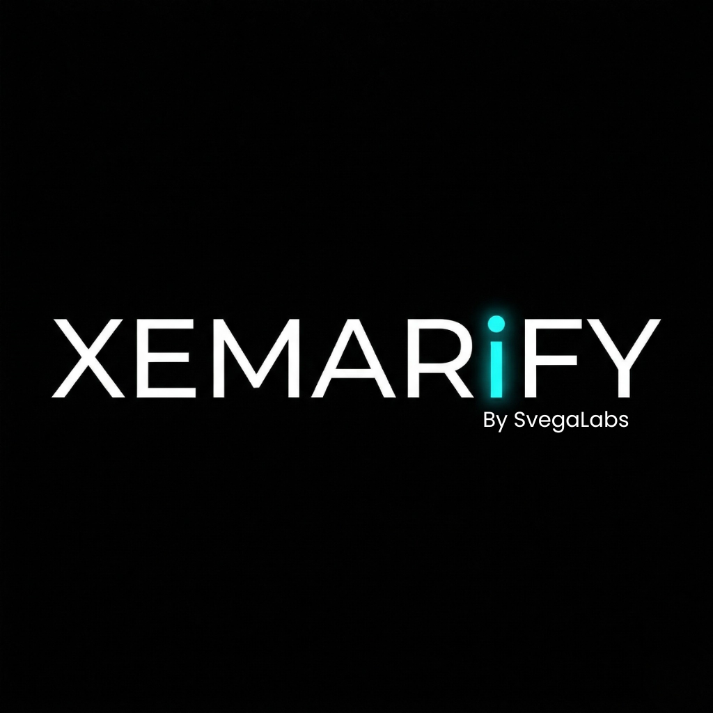

<div align="center">
  

# Xemarify

**Lightweight, self-hosted security event monitoring and rule-based detection.**

Built by **SVEGALABS**

[Features](#features) · [Research results](#research-results) · [Architecture](#architecture) · [Installation](#production-installation) · [Development](#development-setup)
</div>

---

Xemarify collects security-relevant events from monitored Linux hosts, processes them through a stateful rule engine, and presents events and alerts in a centralized web dashboard. It is designed as a lightweight, transparent, and reproducible platform for small environments that need practical security visibility without the operational footprint of a full-scale SIEM.

The project was developed and evaluated as an undergraduate research system. The research has been successfully defended, and its implementation, test tooling, evidence, and documented limitations are retained in this repository for reproducibility.

> [!IMPORTANT]
> Xemarify is a research-backed prototype, not a drop-in replacement for an enterprise SIEM. Review the [known limitations](#known-limitations) before using it in a production or internet-facing environment.

## Features

- **Distributed event collection** through a lightweight Go agent with syslog and file-log inputs.
- **Reliable delivery** using a crash-safe disk spool, retry with exponential backoff, and backpressure handling.
- **Stateful rule-based detection** with threshold, sequence, correlation, and anomaly rule types.
- **Custom detection rules** managed through REST APIs and the dashboard, including enable/disable and hot reload.
- **Centralized investigation** for events, alerts, agents, rules, users, and audit records.
- **Near-real-time visibility** through Server-Sent Events and periodic dashboard refreshes.
- **Role-based access control** with Manager, Analyst, and Viewer roles.
- **Agent enrollment and authentication** using one-time enrollment tokens and per-agent credentials.
- **Operational observability** through health checks and Prometheus-compatible metrics.
- **Resilient processing** with configurable workers, buffered ingestion, bulk persistence, graceful shutdown, and persistent rule state.

## Research Results

The figures below summarize the final measurements recorded in this repository. They describe the tested environment and should not be generalized to different hardware, workloads, rules, or deployment topologies without further testing.

| Evaluation | Result | Test context |
|---|---:|---|
| Highest demonstrated stable load | **3,000 EPS** | 2 vCPU / 4 GB RAM; no errors at the last stable stage |
| Observed instability at tested load | **5,000 EPS** | Confirmed with three 30-second narrow-down runs; the 3,000–5,000 EPS interval was not fully mapped |
| ISO/IEC 25010 security evaluation | **Evidence-based; no aggregate score** | Evaluated by security subcharacteristic rather than a project-defined percentage |
| Weighted functional assessment | **35/50** | 32/40 for primary features and 3/10 for secondary features |
| Detection accuracy | **66.67%** | Nine controlled trials across attack and normal-activity scenarios |
| Detection precision | **100.00%** | 3 true positives and 0 false positives |
| Detection recall | **50.00%** | 3 true positives and 3 false negatives |
| Detection F1-score | **66.67%** | Harmonic mean of precision and recall |

The detection experiment correctly identified all three brute-force trials and produced no false alerts during normal-activity trials. The sensitive-path probing scenario was not detected because its required event type was not produced by the tested target application. This producer gap explains the high precision and lower recall; it is a documented implementation limitation rather than evidence of complete threat coverage.

Security was evaluated directly against the relevant ISO/IEC 25010 subcharacteristics: confidentiality, integrity, non-repudiation, accountability, and authenticity. The evaluation reports evidence, improvements, and remaining limitations for each subcharacteristic. It deliberately does not calculate an overall security score because ISO/IEC 25010 does not define a standardized aggregate scoring formula.

Detailed evidence and methodology are available in:

- [Detection-rate evaluation](tests/detection-rate/README.md)
- [Final detection accuracy report](Bab_4_Akurasi_Rule_Based_Detection_Final.md)
- [Weighted functional assessment](Hasil_4.2.8_Skoring_Fungsional_Berbobot_Manzoor.md)
- [Thesis evidence index](testing/thesis-evidence/README.md)
- [ISO/IEC 25010 test results](docs/pengujian/HASIL_PENGUJIAN_ISO25010.md)

## Performance Results

### Standard EPS Test

| Target load | Average ingest latency | P95 ingest latency | Actual throughput |
|---:|---:|---:|---:|
| 100 EPS | 27.84 ms | 77 ms | 101 EPS |
| 300 EPS | 31.80 ms | 76 ms | 302 EPS |
| 600 EPS | 34.85 ms | 90 ms | 602 EPS |
| 1,000 EPS | 66.00 ms | 276 ms | 1,003 EPS |

No failed events were reported in the standard EPS test runs.

### Capacity Result

- Xemarify remained stable at the tested 2,000 and 3,000 EPS loads.
- No internal event drop or rule-engine degraded state was reported at 3,000 EPS.
- At 5,000 EPS, the narrow-down test produced an average HTTP error rate of 12.69%.
- The highest load demonstrated as stable was 3,000 EPS.
- The exact maximum capacity was not established because the interval between 3,000 and 5,000 EPS was not fully mapped.

The 5,000 EPS result indicates a bottleneck in the HTTP ingestion path, but the specific internal component was not conclusively isolated through profiling.

### Controlled Resource Comparison

During the VU overhead scenario:

| Metric | Xemarify | Wazuh |
|---|---:|---:|
| Agent memory | 11.04 MB | 63 MB |
| Agent CPU | approximately 0% | 0.10% |
| Manager CPU | 1.22% | 28.03% |
| Manager memory | 8.37 MB | 318.52 MB |

These numbers only describe the specific overhead measurement scope.

During the separate EPS container measurement, Xemarify Manager memory increased from approximately 208 MB at idle to 447 MB at 1,000 EPS, while Wazuh was measured at approximately 361 MB and 476 MB respectively.

Process-level overhead measurements and container-level EPS measurements are separate experiments and should not be combined. These results do not establish that Xemarify is universally a fixed number of times lighter than Wazuh.

## Architecture


The main event path is:

```text
Log sources -> Xemarify Agent -> Manager API -> PostgreSQL
                                      |
                                      +-> Rule Engine -> Alerts
                                      |
                                      +-> Web Dashboard / Metrics
```

| Component | Responsibility | Technology |
|---|---|---|
| `agent/` | Collects, normalizes, buffers, and forwards host events | Go |
| `manager/` | Authentication, ingestion, persistence, detection, alerts, audit, and APIs | Go, Gin, pgx |
| `web/` | Security operations dashboard and management interface | SvelteKit, TypeScript, Tailwind CSS |
| PostgreSQL | Events, alerts, rules, users, agents, audit records, and persistent rule state | PostgreSQL |

See the [technical architecture review](TECHNICAL_ARCHITECTURE_REVIEW.md) and [diagram sources](diagrams/d2/README.md) for component boundaries, data flows, deployment topology, rule-engine internals, and the summarized data model.

## Technology Stack

- Go 1.25+ with Gin for the Manager
- Svelte 5, SvelteKit, and TypeScript for the dashboard
- PostgreSQL for durable storage
- Docker and Docker Compose for deployment
- Prometheus-compatible application metrics
- k6 and repository test tooling for performance evaluation

## Production Installation

### Requirements

- One Ubuntu 22.04 LTS host for the Manager and Web dashboard
- One or more Ubuntu hosts for Xemarify Agents
- Network access from each Agent to the Manager
- `sudo` access on installation targets

### 1. Install the Manager and Dashboard

Run this on the Manager host:

```bash
curl -fsSL https://raw.githubusercontent.com/hildanku/xemarify/main/deploy/manager/install.sh | sudo bash
```

To pin a release:

```bash
curl -fsSL https://raw.githubusercontent.com/hildanku/xemarify/main/deploy/manager/install.sh | \
  sudo MANAGER_VERSION=<VERSION> WEB_VERSION=<VERSION> bash
```

The installer installs Docker when necessary, generates deployment credentials, starts PostgreSQL, Manager, and Web containers, and prints the dashboard URL with a one-time setup token.

Open `http://<MANAGER_IP>:3000` and use the one-time token to create the first Manager account.

### 2. Enroll an Agent

Create an enrollment token from **Agents -> Enroll New Agent** in the dashboard, then run this on the monitored host:

```bash
curl -fsSL https://raw.githubusercontent.com/hildanku/xemarify/main/deploy/agent/install.sh | \
  sudo MANAGER_ENDPOINT=http://<MANAGER_IP>:8089 \
  ENROLLMENT_TOKEN=<ENROLLMENT_TOKEN> bash
```

To pin the Agent version, add `VERSION=<VERSION>` before `bash`.

The installer downloads the release binary, creates the Agent configuration and runtime directories, installs a systemd service, and enrolls the host with the Manager.

### 3. Verify the Deployment

On the Manager host:

```bash
cd /opt/xemarify
docker compose ps
```

On an Agent host:

```bash
systemctl status xemarify-agent
```

> [!CAUTION]
> The default deployment uses HTTP. Put Xemarify behind a TLS-enabled reverse proxy, protect Manager and database ports with a firewall, and use a trusted private network before handling real security events.

## Development Setup

### Prerequisites

- Go 1.25+ for `manager/`and `agent/`
- Node.js 22+
- Docker with Docker Compose
- [`golang-migrate`](https://github.com/golang-migrate/migrate) CLI

### 1. Start PostgreSQL

From the repository root:

```bash
docker compose up -d
```

The development database listens on `localhost:5445` by default.

### 2. Start the Manager

```bash
cd manager
cp .env.example .env
make migrate-up
make dev
```

Before starting the service, replace all placeholder credentials in the local environment file. Do not commit that file. The API listens on `http://localhost:8089` by default.

### 3. Start the Dashboard

In a second terminal:

```bash
cd web
npm install
npm run dev
```

The development dashboard runs at `http://localhost:5173` and connects to the Manager API on port `8089` by default.

### 4. Start an Agent (Optional)

Use `agent/example.yaml` as a template, install it at the Agent's expected configuration path, and add an enrollment token created by the Manager:

```bash
cd agent
sudo install -d -m 750 \
  /etc/xemarify-agent \
  /var/lib/xemarify-agent/spool \
  /var/log/xemarify-agent
sudo install -m 600 example.yaml /etc/xemarify-agent/agent.yaml
sudoedit /etc/xemarify-agent/agent.yaml
go build -o xemarify-agent .
sudo ./xemarify-agent
```

Keep enrollment tokens and generated Agent credentials out of Git and terminal logs.

### Default Development Ports

| Service | Port |
|---|---:|
| PostgreSQL | `5445` |
| Manager API | `8089` |
| SvelteKit development server | `5173` |
| Agent syslog listener | `5514/UDP` |

## Testing

Run the component test suites independently:

```bash
# Agent
cd agent && go test ./...

# Manager
cd manager && go test ./...

# Dashboard
cd web && npm test
```

Performance, security, detection-rate, and thesis evidence suites live under `testing/`, `tests/`, and `xemarify-testing/`. Several suites require a dedicated deployment and can generate significant traffic; read their local documentation before running them.

## Repository Structure

```text
.
├── agent/                  # Host event collector and delivery pipeline
├── manager/                # Core API, storage, rule engine, and alerting
├── web/                    # SvelteKit dashboard
├── deploy/                 # Production installers and deployment configs
├── diagrams/               # Architecture diagrams and D2 sources
├── docs/                   # Design, research, and test documentation
├── testing/                # Evidence and evaluation artifacts
├── tests/                  # Detection-rate and supporting tests
├── xemarify-testing/       # Load and security test infrastructure
├── wazuh-http-adapter/     # Comparative Wazuh benchmark adapter
└── ppdbman21jkt/           # Target application used in the research setup
```

For a broader documentation index, see [DOCS_MAP.md](DOCS_MAP.md).

## Known Limitations

- The default transport is HTTP; TLS or mTLS is not enabled by default.
- Agent event payloads are authenticated but are not cryptographically signed.
- Audit records are structured but are not yet tamper-evident.
- Retention policies, automated archival, and cleanup jobs are not implemented.
- The Manager uses a single-node architecture without horizontal scaling or high availability.
- Threat-intelligence feeds, vulnerability scanning, and compliance reporting are outside the current feature set.
- Detection coverage depends on the event types produced by each monitored application and the installed rule pack.

These constraints are part of the documented research findings and form a practical roadmap for future development.

## Contributing

Issues and pull requests are welcome. For substantial changes, open an issue first to describe the use case, proposed behavior, and how the change will be tested. Never include production logs, tokens, credentials, personal data, or other sensitive evidence in a report or contribution.

## License

Xemarify is licensed under the [GNU Affero General Public License v3.0](LICENSE).
